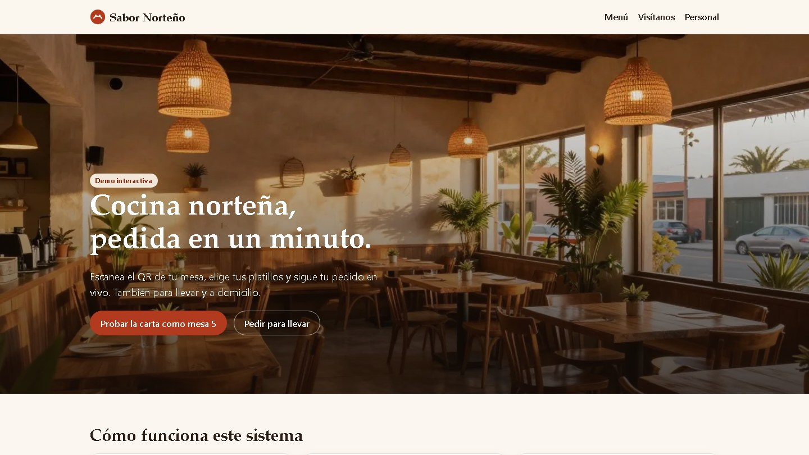
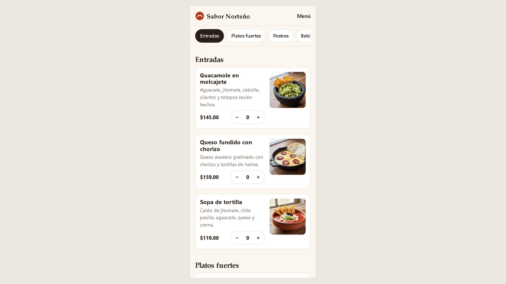

# Restaurant QR Menu + Online Ordering (demo)

**Live demo:** https://demo-restaurante-anx.pages.dev · Kitchen: https://demo-restaurante-anx.pages.dev/cocina · Admin: https://demo-restaurante-anx.pages.dev/admin (demo users are shown on the login screen)

A digital menu guests open by scanning a QR code at the table, which can send the order straight to the kitchen. The restaurant owns the system, so there are no monthly software fees and no per-order commissions.




## What it does

- Fast, mobile-first menu with photos, categories and sold-out badges
- Optional ordering: the total is always calculated on the server, so prices can't be tampered with
- Live order status for the guest
- Kitchen screen that picks up new orders automatically every few seconds
- Admin panel: edit prices, mark items sold out, open or close the shop, sales report with CSV export
- Privacy notice and legal pages included, SEO ready

## Stack

TypeScript · Hono on Cloudflare Pages Functions · Cloudflare D1 (SQLite) · Vite · Zod validation · Vitest + Miniflare (API tests) · Playwright (end-to-end tests)

## Run locally

```bash
npm install
npm run db:local
npm run preview
npm test            # API tests
npm run test:e2e    # browser tests
```

**Hire me:** [Fiverr](https://www.fiverr.com/maik240) · [GitHub profile](https://github.com/MaikolProx) · Remote work, English and Spanish.
